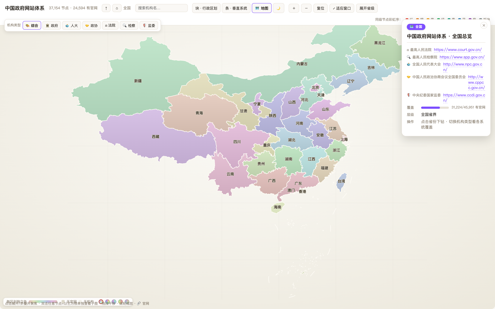
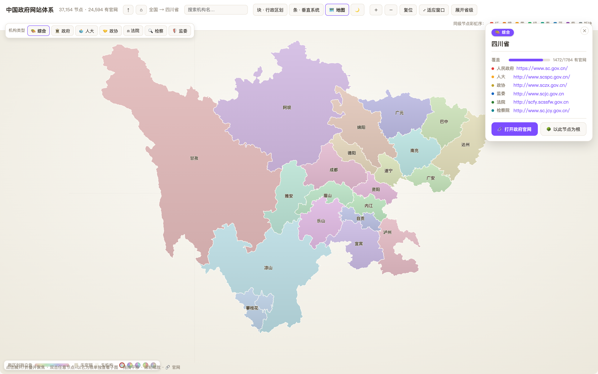
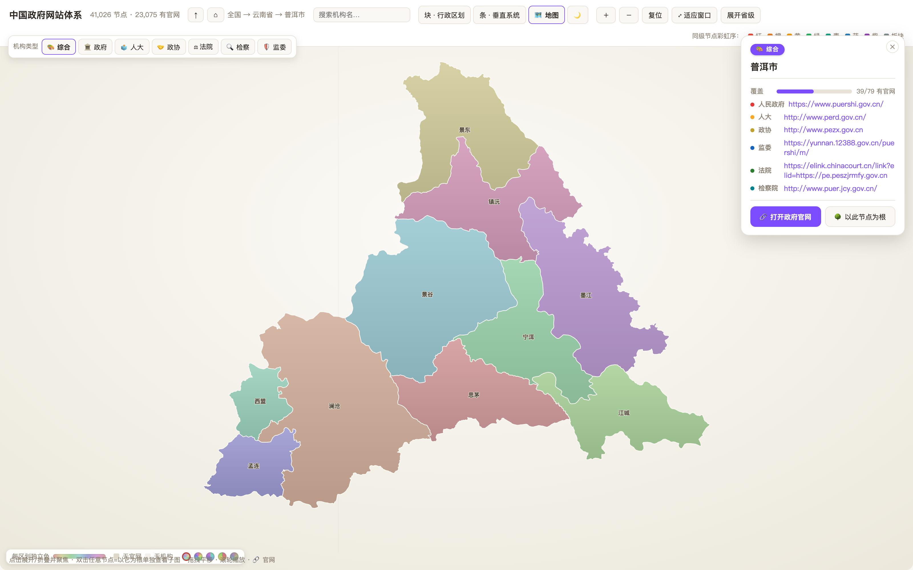
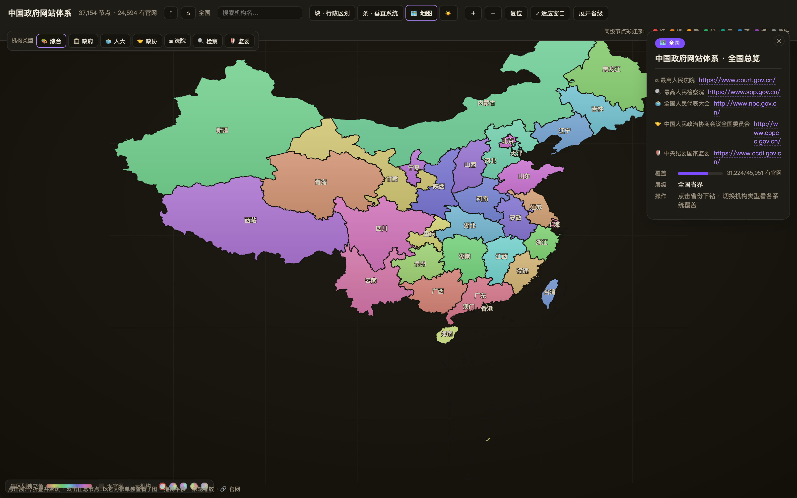
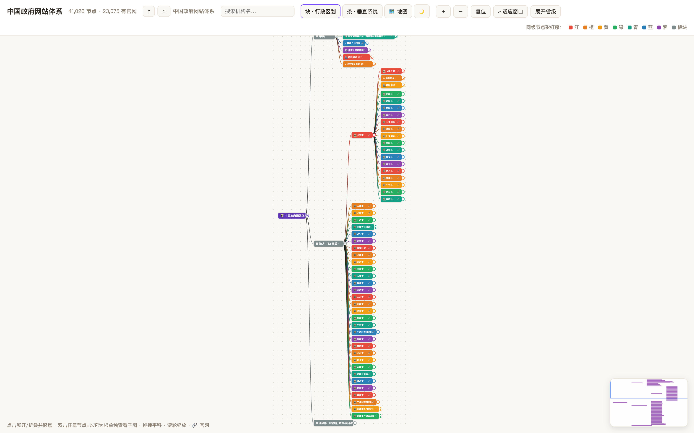
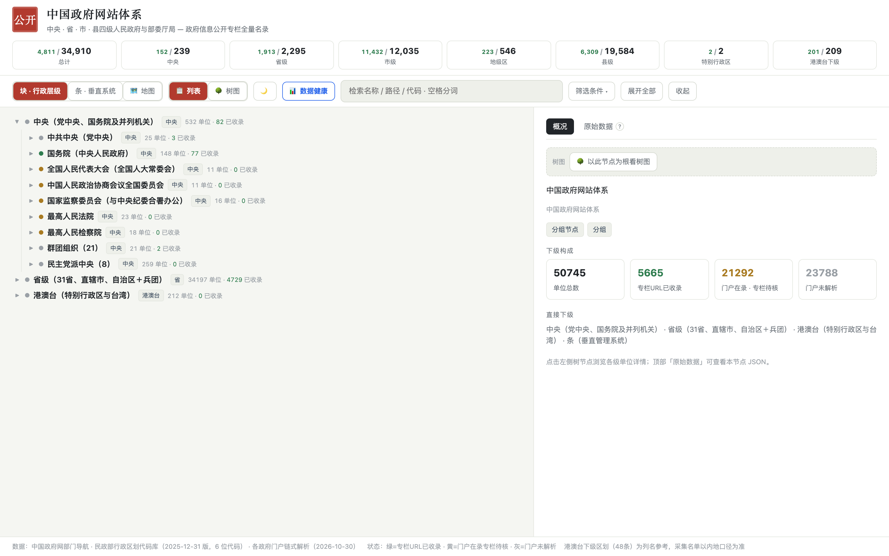

<div align="center">

# 中国政府网站体系 · 政府机构官网名录

**forager-gov** — 块（行政区划）× 条（垂直系统）双维数据 · 列表 / 树状图 / 地图三视图 · 零域名猜测

从国务院部委到省、市、县人民政府，从人大、政协、纪委监委、法院、检察院
到群团组织与卫生健康系统，用**同一条注册表**整理每一个机构的官方网站入口。

[](https://forager-gov.pages.dev)
[](#-数据覆盖)
[](#-数据覆盖)
[](data/URL_STATS.md)
[](docs/screenshots/map-china.png)
[](#-数据来源与红线)
[](https://github.com/jimmy-Smile-ltl/forager-gov/stargazers)

**在线访问**：<a href="https://forager-gov.pages.dev" target="_blank">forager-gov.pages.dev</a>
· **代码仓库**：<a href="https://github.com/jimmy-Smile-ltl/forager-gov" target="_blank">github.com/jimmy-Smile-ltl/forager-gov</a>

<a href="https://forager-gov.pages.dev/gov-tree.html#/map" target="_blank">
  
</a>

<sub><b>全国地图（综合覆盖率）</b> · 每个区划按覆盖率在色环上独立配色，灰色 = 该类机构无官网；
点击省份看市级地图，点击城市看县级地图，右侧档案卡展示机构名录与官网链接。</sub>

<br>

[](#county-coverage)
[](#county-coverage)

**2,768 / 2,778 个县级人民政府拥有官网入口**（民政区划口径，不含开发区 / 高新区 / 示范区
等功能区节点）。剩余 10 个：三沙海岛区划 ×5、金门县、新设和康 / 和安县，以及万宁、保亭
两个待补缺口——**没有一个靠猜测补上，全部留名留痕。**

<br><br>

<sub><i>A source-verified directory and interactive map of official Chinese government
websites — covering State Council ministries, provincial / municipal / county governments,
People's Congresses, CPPCC bodies, courts, procuratorates, supervisory commissions,
mass organizations and the health system.</i></sub>

</div>

---

## 📖 项目简介

**中国政府网站体系（forager-gov）** 是一份持续维护的中国政权机构（人民政权机构）
官方网站名录与覆盖地图：

- **块视图**：中央 → 31 省区市（+ 新疆兵团）→ 地级市 → 区县。每级包含
  「人民政府 + 并列机关（党委 / 人大 / 政协 / 监委 / 法院 / 检察院 / 群团）」与政府部门。
- **条视图**：按垂直 / 半垂直系统组织——人大、政协、纪委监委、法院、检察院、外交、
  财经、海关等国务院垂直管理 13 个子系统、群团组织、气象、地震、医疗（卫生健康）、
  药监、烟草、邮政、铁路。
- **三视图**：同一份数据投影为**列表**、**树状图**与**行政区划地图**，无需任何构建依赖。
- **权威来源**：所有 URL 来自官方页面真实 HTML（上级机构名录 > 同级政府门户导航 >
  官网互链）；SERP 仅作发现线索，必须回官方页面做标题身份验证并留痕。
- **零猜测**：无官网的机构保留名称、官网为空（列名展示 `u=""`），不拼域名、不试 DNS、
  不把「能响应」当官网；每个缺口节点的 `m` 字段留有原因。

> 一句话：**把「中国政府机构官网有哪些、建站率多高、地图上怎么分布」整理成可核查的开数据。**

---

## ✨ 核心特性

| 特性 | 说明 |
|---|---|
| 🧭 **块 × 条双维树** | 同一机构在行政区划视图与垂直系统视图各出现一次，共用 `site_registry.json` 注册表，一个机构一条记录 |
| 🏆 **县级覆盖 99.64%** | **2,768 个县级人民政府官网入口**；仅 10 个特殊区划留名（三沙海岛 / 金门 / 新设县），无一猜测 |
| 🗺️ **三级下钻地图** | 全国省界 → 省级看市级 → 市级看县级；港澳台、直辖市区县、兵团市等特例均已兼容 |
| 🎨 **每区划独立配色** | 覆盖率升序 × 黄金角 137.508° 全环展开，相邻覆盖率色距恒定；5 套配色方案、白天 / 夜晚主题 |
| 🌐 **纯静态、无外链** | 地图为纯手写 SVG（无 ECharts / D3），边界数据本地化惰性加载，支持 `file://` 直开 |
| 🔍 **来源分级与留痕** | 注册表记录 `source_level`（L1 官网名录 / L2 门户导航 / L3 兜底验证）、来源、快照、验证时间 |
| 🩺 **健康巡检** | URL 全量巡检 `ok / dead / maintain`，连续两轮 dead 才列名；`verified_at` 记录复验时间 |
| 📦 **快照与备份** | 采集快照（snapshots）、结构变更前自动备份、发布包三道校验（引用完整 / 限额 / 泄漏） |
| 🔎 **可核查性** | 提取规则、来源留痕、缺失原因全部随数据发布，宁可空缺也不采信未验证链接 |

---

## 🖼️ 界面预览

<table>
  <tr>
    <td width="33.33%" align="center">
      <a href="https://forager-gov.pages.dev/gov-tree.html#/map/四川省" target="_blank">
        
      </a>
      <br><b>省级下钻 · 四川</b><br>
      <sub>点击省份查看市级地图，右侧显示全省覆盖率与并列机关官网</sub>
    </td>
    <td width="33.33%" align="center">
      <a href="https://forager-gov.pages.dev/gov-tree.html#/map/云南省/普洱市" target="_blank">
        
      </a>
      <br><b>市级下钻 · 普洱</b><br>
      <sub>县级人民政府官网一网打尽，县县不同色（色相序 = 覆盖率序）</sub>
    </td>
    <td width="33.33%" align="center">
      <a href="https://forager-gov.pages.dev/gov-tree.html#/map" target="_blank">
        
      </a>
      <br><b>夜晚模式</b><br>
      <sub>白天 / 夜晚一键切换，地图配色、海洋、标注同步重绘</sub>
    </td>
  </tr>
</table>

<table>
  <tr>
    <td width="50%" align="center">
      <a href="https://forager-gov.pages.dev/gov-tree.html#/tree/blk" target="_blank">
        
      </a>
      <br><b>树状图视图</b><br>
      <sub>块 / 条双视图切换，搜索定位、拖拽缩放、点击节点看档案卡</sub>
    </td>
    <td width="50%" align="center">
      <a href="https://forager-gov.pages.dev/中国政府网站体系.html" target="_blank">
        
      </a>
      <br><b>列表视图</b><br>
      <sub>按类型 / 地区 / 健康状态筛选，展示来源等级与信息公开专栏</sub>
    </td>
  </tr>
</table>

---

## 📊 数据覆盖

统计由 [`data/p221_url_stats.py`](data/p221_url_stats.py) 自动生成（p22 管线调用，
**统计生成日期：2026-11-17**），完整报告见 [`data/URL_STATS.md`](data/URL_STATS.md)；
站点右上角「数据健康」面板同步展示。
「缺失」= 树中该机构**无官网**（`u=""`，列名展示），不代表官网已失效（死链由注册表
`status` 字段单独承载）。

### 分等级

| 等级 | 机构数 | 有官网 | 缺失 | 缺失率 |
|---|---:|---:|---:|---:|
| 省级 | 2,216 | 2,014 | 202 | 9.12% |
| 市级 | 8,607 | 8,312 | 295 | 3.43% |
| 县级 | 16,805 | 11,550 | 5,255 | 31.27% |
| **合计** | **27,628** | **21,876** | **5,752** | **20.82%** |

### 🏆 县级人民政府：王牌指标

<a id="county-coverage"></a>

> 全国 2,900+ 个县级节点、300+ 个市级门户、逐站 JS 渲染 / 下拉 / 别名 / 简称 / 民族语 /
> 合署更名形态逐一攻克——**县级人民政府官网覆盖率达到 99.64%**，这在公开、可核查的
> 政府网站数据中极为罕见。

| 口径 | 覆盖率 | 说明 |
|---|---:|---|
| **县级人民政府（民政区划口径）** | **2,768 / 2,778 = 99.64%** | 剔除开发区 / 高新区 / 示范区 / 管理区等非民政区划序列的功能区节点 |
| 县级人民政府（含功能区，官方统计口径） | 2,833 / 2,910 = 97.35% | p221 自动统计；功能区/管委会多数无独立门户，属正常形态 |
| 地级市人民政府 | 333 / 333 = 100% | 全国 333 个地级市（地区 / 州 / 盟）全部覆盖 |
| 省级人民政府 | 32 / 32 = 100% | 31 省区市 + 新疆兵团（台湾省无大陆政府门户，另计） |
| 直辖市辖区 | 73 / 74 = 98.65% | 渝北区因 2025 年区划调整并入两江新区，机构本身已不存在 |

未覆盖的 10 个县级单位全部**留名 + 留痕**，无一猜测：

- 三沙市西沙区、南沙区、西沙群岛、南沙群岛、中沙群岛（5 个）：海岛区划，无县级政府门户网站；
- 金门县：实际由台湾当局管辖，无大陆人民政府门户；
- 和康县、和安县（新疆和田）：新设县，官网尚未建成；
- 万宁市、保亭黎族苗族自治县（海南）：待补数据缺口，已列入采集清单。

> 换句话说：**除体制性无官网和新设县外，中国大陆每一个县级人民政府的官网入口都在这里。**
> 这 2,768 个入口均来自官方页面真实 HTML（上级名录 / 门户导航提取，SERP 仅作线索并经
> 标题身份验证），不是搜索结果拼凑，更不是域名猜测。

### 分系统 × 等级 缺失率

| 系统 | 省级 | 市级 | 县级 | 合计 |
|---|---:|---:|---:|---:|
| 政府门户 | 0.00% | 0.25% | 2.65% | 2.33% |
| 政府部门（厅局 / 市局） | 0.00% | 0.00% | — | 0.00% |
| 人大 | 0.00% | 15.80% | 69.20% | 61.80% |
| 政协 | 0.00% | 33.33% | 82.66% | 75.65% |
| 监委 / 纪委 | 0.00% | 5.93% | 4.14% | 4.32% |
| 法院 | 0.00% | 8.15% | 13.60% | 12.78% |
| 检察院 | 0.00% | 9.38% | 16.73% | 15.65% |
| 群团 | 25.92% | 0.00% | — | 19.50% |
| 民主党派 | 24.70% | — | — | 24.70% |

> **读法**：政府门户与政府部门已基本全覆盖（缺失率 ≤ 2.65%）；县级监委通过中央纪委
> 12388 举报网站名录体系补齐至 **95.9% 有官网**（2,664 / 2,779）；市级监委 94.1%
> （381 / 405）。县级人大 / 政协仍是最大缺口（缺失 69.2% / 82.7%），原因有两层：
> ① 区县人大、政协绝大多数没有独立门户，其内容以「领导之窗 / 建议提案办理 /
> 会议报道」等**门户栏目**形式挂在县政府门户下——2026-11-17 全量复核把这类
> 栏目页（约 400 条）判为「非机构官网」清出，宁缺毋滥；② 真正独立建站的县级
> 人大 / 政协，四档渠道（上级名录 / 本级门户导航 / 同级互链 / SERP 线索+严格
> 验证）已基本穷尽——2,341 个县级门户全量重挖后净增仅约 40 条。党委机关不设
> 独立门户网站，不纳入统计。每个缺口节点的 `m` / `s` 字段留有具体原因。

### 注册表与巡检

| 指标 | 数值 |
|---|---:|
| 官网注册记录（去重后，有 URL） | 25,364 |
| 注册表条目（含审计清空的历史条目） | 25,815 |
| 来源 L1 官网名录 / L2 门户导航 / L3 兜底验证 | 8,873 / 14,112 / 2,379 |
| 健康状态 ok / maintain / dead / 未巡检 | 22,992 / 42 / 517 / 1,813 |
| 树节点（块树 + 条树，含分组容器） | 37,426 + 17,687 |
| 行政区划边界文件（DataV + 港澳 + 台湾） | 360+ / 约 27 MB |

---

## 🚀 快速开始

站点是**纯静态**的，无构建依赖：

```bash
python3 -m http.server 8765
# 打开 http://localhost:8765/中国政府网站体系.html   （主查看器：列表 / 树图 / 地图）
#      http://localhost:8765/gov-tree.html          （树图 + 地图查看器）
```

也可以用任意静态服务器；直接双击 HTML（`file://`）同样可用——数据按需以 `<script>` 惰性加载。

### 数据管线（每次数据改动必跑）

```bash
# 1. 拆分数据 + 生成三视图数据（p22 内部自动调用 gen_viz）
cd data && uv run python p22_split_data.py && cd ..

# 2. 重建主查看器
cp 模板.html 中国政府网站体系.html

# 3. 自检（必须 0 问题项）
uv run python data/p99_weekend_check.py

# 4. 构建发布包（本地验证）
cd data && uv run python p219_build_dist.py && cd ..
```

### 部署（Cloudflare Pages）

**方式 A：关联 GitHub 仓库（推荐，push 即发布）**

Cloudflare Dashboard → Workers & Pages → Create → Pages → Connect to Git →
选择 `jimmy-Smile-ltl/forager-gov`，构建设置：

| 设置项 | 值 |
|---|---|
| Production branch | `main` |
| Build command | `python3 data/p219_build_dist.py` |
| Build output directory | `dist` |
| Root directory | `/` |

`p219_build_dist.py` 只用 Python 标准库，无需安装依赖。每次 `git push` 自动构建发布。

**方式 B：本地构建 + 直传**

```bash
npx wrangler login                          # 首次
cd data && uv run python p219_build_dist.py # 生成 dist/
npx wrangler pages deploy dist --project-name=forager-gov
```

发布包只含站点运行所需资产（两 HTML + 视图脚本 + gov_data.js + data_js + data/geo），
采集脚本、state、快照、备份一律不进发布包；`p219` 自带引用完整性、Pages 限额
（单文件 25MiB / 20000 文件）与泄漏三道校验。

---

## 📁 仓库结构

```
├── 中国政府网站体系.html      # 主查看器（列表 / 树状图 / 地图）
├── gov-tree.html              # 树图 + 地图专用查看器
├── 模板.html                  # 主查看器模板（数据管线复制为上面的成品）
├── map_view.js / tree_view.js # 地图 / 树图视图（纯手写，无外部依赖）
├── gov_data.js                # 统一数据（p22 生成）
├── gov_data_records.js        # USR 扁平全字段索引（约 5 万条叶子）
├── docs/screenshots/          # 界面截图（README 素材）
├── data_js/                   # 拆分后的数据模块（manifest / modules / rules / quality）
├── data/
│   ├── tree.json              # 事实源（块 + 条）
│   ├── site_registry.json     # 网站注册表（URL / 来源等级 / 健康状态 / 信息公开专栏）
│   ├── extraction_rules.json  # 提取规则（键 = 机构/区划，method 留痕来源）
│   ├── geo/                   # 行政区划边界（DataV + taiwan-atlas，惰性加载）
│   ├── URL_STATS.md           # URL 缺失率统计报告（p221 生成）
│   ├── p*_*.py                # 采集 / 治理 / 管线脚本（274 个，见 data/INDEX.md）
│   └── INDEX.md               # 脚本索引
├── util/                      # 通用工具（获取层实现不随本仓库发布，见「数据来源与红线」）
├── 体系设计.md                # 架构、数据模型、权威源体系、采集纪律
└── 政府信息公开官网名单.csv    # 早期导出名单
```

核心数据文件说明：

| 文件 | 作用 |
|---|---|
| `data/tree.json` | 存库层唯一事实源（块树 + 条树，节点 schema `{n,l,k,c,u,x,s,m,ks}`） |
| `data/site_registry.json` | 网站注册表（主数据：URL / 来源等级 / 健康状态 / 信息公开专栏） |
| `gov_data.js` | 展示层唯一入口 `window.__GOV_DATA__ = {meta, block, tiao}`（p22 自动生成） |
| `gov_data_records.js` | USR 扁平全字段索引，`__GOV_DATA__.loadRecords()` 按需加载，不阻塞首屏 |

---

## 🧭 数据来源与红线

- **禁止猜测域名**：不做拼音/缩写探测、DNS 试探或「能响应就算官网」；所有 URL 来自官方页面真实 HTML。
- **无官网列名**：`u=""` 展示名称，不降级保留探测数据。
- **SERP 仅作线索**：搜索引擎结果必须回到官方页面做标题身份验证，并在 `s` 字段留痕。
- **获取层抽象**：脚本统一调用 `smart_fetch(url)` 获取真实 HTML；获取层实现
  （浏览器/指纹/WAF 处理）不随本仓库发布。
- **不发布内容**：`.env`、cookies、`*_state.json`、snapshots、backups、dist、
  内部规则文档不进入仓库。
- 数据来自各级政府公开网站，仅作机构名录与官网入口整理；如发现错漏，欢迎提 issue。

---

## 📚 相关文档

| 文档 | 内容 |
|---|---|
| [`体系设计.md`](体系设计.md) | 块/条架构、USR 数据模型、权威源体系、采集纪律、板块状态总表 |
| [`data/URL_STATS.md`](data/URL_STATS.md) | URL 缺失率统计报告（省 / 市 / 县 × 系统） |
| [`data/INDEX.md`](data/INDEX.md) | 150+ 采集脚本按主题分类索引 |
| [`README.md` 附录](#map-appendix) | 地图 Geo 数据来源与纯手写 SVG 绘制方法 |
| [在线站点](https://forager-gov.pages.dev) | Cloudflare Pages 部署的实时版本 |

---

## ❓ 常见问题

<details>
<summary><b>收录范围是什么？敏感系统收录吗？</b></summary>

收录国务院组成部门及直属机构、地方各级人民政府与政府部门、人大、政协、纪委监委、
法院、检察院、群团组织、民主党派，以及海关 / 税务 / 人民银行 / 气象 / 地震 /
卫生健康等垂直与半垂直系统。军队、公安、国家安全等敏感系统不采集。

</details>

<details>
<summary><b>为什么有些机构没有官网链接？</b></summary>

两种情况：① 该机构确实无独立公开官网——县级人大 / 政协多由本级政府门户代管栏目，
党委机关不设独立网站，这是体制性建站率差异，不是采集遗漏；② 暂未找到
符合「权威源验证」要求的官网。按数据红线，宁缺毋滥、列名展示（`u=""`），不猜测域名。

</details>

<details>
<summary><b>数据多久更新一次？</b></summary>

采集与治理脚本按批次滚动执行，URL 健康状态全量巡检（连续两轮 dead 才列名），
统计报告随数据管线自动再生成。可在 [`data/URL_STATS.md`](data/URL_STATS.md)
查看生成日期。

</details>

<details>
<summary><b>可以离线使用 / 二次开发吗？</b></summary>

可以。站点是纯静态文件（HTML + JS + JSON + GeoJSON），无后端、无运行时外部依赖，
`file://` 直接打开即可；数据与地图边界可独立复用（注意各数据源许可与「仅作机构
名录整理」的使用边界）。

</details>

## 🤝 反馈与贡献

- 发现**官网错配、死链、遗漏机构**：请开 issue 并附官方来源页面。
- 数据修正请遵循「权威源优先级」：上级机构官网名录 > 同级政府门户导航 > SERP 严格验证。
- 欢迎补充缺失机构的**官方导航栏目页链接**（而非直接猜域名）。

---

<a id="map-appendix"></a>

<details>
<summary><b>🗺 附录：地图子系统技术文档（Geo 数据来源与绘制方法）</b></summary>

本文档说明「中国政府网站体系」中行政区划地图（`gov-tree.html` / `中国政府网站体系.html` 的 🗺 地图视图）的 **Geo 数据来源** 与 **绘制方法**。

### 一、Geo 数据来源

地图底图使用本地化的行政区划边界数据（`data/geo/`，共 360+ 文件约 27MB），**不依赖任何运行时外链**。数据来源分两类：

#### 1. 阿里云 DataV GeoAtlas（主源，全国大陆 + 港澳）

- **地址**：`https://geo.datav.aliyun.com/areas_v3/bound/{adcode}(_full).json`
  - `{adcode}.json`：该区划**自身**的边界
  - `{adcode}_full.json`：该区划**及其全部下级**的边界集合（我们主要用这个）
- **坐标系**：GCJ-02（火星坐标，大陆范围），字段为经纬度
- **下载打包**（`data/dl_geo.py`，断点续跑、幂等）：
  | 产物 | 来源 | 内容 |
  |---|---|---|
  | `geo/china.js` | `100000_full.json` | 全国省界（35 省级特征，含港澳台省界） |
  | `geo/geo_{省}0000.js` | 各省 `_full.json` 的市级特征 | 省图 = 市级图（点省下钻显示） |
  | `geo/geo_{市}00.js` | 各市 `_full.json` 的县级特征 | 市图 = 县级图（点市下钻显示） |
  | `geo/geo_810000.js` / `geo_820000.js` | 港澳 `_full.json` | 香港 18 区 / 澳门 8 堂区（三级变两级） |
  | `geo/geo_index.js` | 由磁盘文件反查生成 | `__GEO_CITY_FILES__` 市级下钻清单（有县级文件的市级 adcode） |

- **特例处理**：
  - **直辖市**（北京/天津/上海/重庆）：省下无市级层，`geo_{直辖市}0000.js` 直接存区县（三级变两级）
  - **台湾**：DataV 无县市边界（`710000` 的 `childrenNum=0`）→ 见下文第 2 类
  - **嘉峪关市 / 新疆兵团市**：DataV 无县级边界文件（404 为正常）→ 不在 `geo_index.js` 清单，点击直接看详情
  - **海南省三沙市**：geo 文件含南海诸岛（南至北纬 3.8°），主图范围扫描时跳过，单独画右下角「南海诸岛」插图

#### 2. taiwan-atlas（台湾 22 县市）

- **仓库**：`github.com/dkaoster/taiwan-atlas`（MIT）
- **原始数据**：台湾内政部开放资料「直辖市、县市界线（TWD97 经纬度）」，经该仓库转档为 TopoJSON
- **下载**：`https://cdn.jsdelivr.net/npm/taiwan-atlas/counties-10t.json`
- **转换**（`data/p197_taiwan_geo.py`，已挂入 dl_geo.py）：
  1. TopoJSON 解码：`transform.scale/translate` 量化还原 + delta 编码弧线解码 → 绝对经纬度
  2. **繁体转简体**（縣→县、臺→台、連→连、嘉義→嘉义……22 县市名全量映射）
  3. **一个中国原则**：台湾省保持挂在全国省界下，点击下钻 22 县市（含金门县/连江县，与块树结构一致），不单独成图；文件头注释数据来源
  4. adcode 稳定表（710100 台北市起）；bbox 中心作为标注锚点
- **坐标说明**：TWD97 与 WGS84 差异 <1 米，直接并入经纬度投影，无纠偏

#### 3. 加载方式（file:// 兼容）

- 每个 geo 文件打包为 `window.__GEO_{adcode}__ = {FeatureCollection}` 的 `<script>`，地图**按需惰性加载**（`<script src>` 动态插入）——因为 `file://` 下 `fetch()` 被 CORS 拦截，不能用 AJAX
- 结构（与 DataV 一致）：`features[].properties = {adcode, name, center, centroid}`，`geometry = Polygon / MultiPolygon`

#### 4. 慢网加载优化（预取 / 缓存 / 反馈）

线上 pages.dev 的 TTFB 约 1–2.5s，单文件下钻等待明显。三层优化：

- **瘦身**：`gov_data.js` 只留 block/tiao 树（21MB→4.9MB raw），USR 全字段索引拆为
  `gov_data_records.js`（`loadRecords()` 按需加载）——首屏 payload 降约 2/3。
- **缓存**：发布包 `dist/_headers` 给 `/data/geo/*` 一年 `immutable`（靠 `?v=` 版本戳失效）、
  `/data_js/*` 1 小时、`gov_data.js`/`gov_data_records.js` 与视图脚本 1 天。
- **预取**：构建期把一省全部市级边界合并为 `geo_bundle_{省码}.js`（`window.__GEO_BUNDLE__`），
  省图渲染完即预取 —— 点任意市**零请求**直接画县级图；包在途时与单文件赛跑（`Promise.any`）
  取先到者。bundle 只在发布包生成，本地 `file://` 自动回退逐文件加载。
- **反馈**：加载胶囊（spinner + 已等待秒数 + shimmer 进度条）、点击涟漪、失败 toast；
  `loadSeq` 序号保证连点只渲染最后一次的目标，过期结果丢弃。

### 二、绘制地图的方法

地图由 `map_view.js`（MapViz，约 700 行）**纯手写 SVG** 绘制，无 ECharts/D3 依赖（规避 CSP 与外链限制），两个查看器共用同一份代码。

#### 1. 投影：等距圆柱投影

```js
// project(features[0]) 按当前 range（全国/省/市各自适配）计算：
// 容器宽高 W×H，经纬范围 [minLon,maxLon]×[minLat,maxLat]
k = min(W/(maxLon-minLon), H/(maxLat-minLat)) * 0.94   // 保持纵横比居中
x = ox0 + (lon - minLon) * k
y = oy0 + (maxLat - lat) * k                            // 北在上
```

下钻时 `setGeo(adcode)` 用该省/市特征的**边界框**重算 range → 每级地图自动满幅适配。

#### 2. 几何：Polygon / MultiPolygon → SVG path

`pathOf(geom, pr)`：Polygon 逐 ring、MultiPolygon 多解一层（曾因少解一层出现 `MNaN,NaNZ`），每环 `M…L…Z` 闭合。

#### 3. 渲染分层（render()）

```
svg
├── defs    渐变定义: 每区划独立色 + 灰态 + 海洋径向暗角渐变
├── rect    海洋背景（径向渐变: 中心亮、四角暗 = vignette）
├── g       经纬网氛围线（10° 一格, 6-7% 透明度, 静态不随缩放）
├── rootG   陆地组（变换目标: translate+scale 应用于此组, 海洋/网格不动）
│   ├── g.mz × N   每区划一组: path(填充/描边)
├── labelG  地名标注层（最后挂载，保证不被多边形覆盖）
└── [插图]  南海诸岛（三沙市）右下角小框（drawInset, 独立小投影）
```

#### 4. 着色管道（五步）

1. **深聚合统计** `calcStats(t)`：块树 DFS——每个区划节点递归整棵子树，按机构类型统计「有官网/总数」（省=全省辖域、市=全市、县=全县）；兼容省级节点 `t="group"` 挂 u、直辖市辖区 `c=直辖市辖区` 等形态
2. **取值** `covOf(name)`：当前类型覆盖率；名称经 `baseName` 归一（剥行政区后缀+民族修饰+「（…）」尾注）——geo 特征名、树节点名、官网简称三方互通
3. **每区划独立色**：有数据的区划按覆盖率升序 × 黄金角（137.508°）在色环展开，相邻覆盖率色距恒定；灰 = 无官网/无机构（5 套配色方案可在图例切换）
4. **末级降级**：区县级单类型数据天然二元（每县该类型机构仅 1 个, 有/无）→ 无差异可显时自动改按**综合覆盖**着色（`fillCache`），tooltip/详情仍显示该类型真实值（`covCache` 分离）
5. **填色** `colorOf`：按区划取调色板颜色；hover/选中另加描边与光晕

#### 5. 交互

| 交互 | 实现 |
|---|---|
| 三级下钻 | 全国省界 → 点省看市级 → 点市看县级（`CITY_FILES` 清单裁决：无县级文件的区划点击直接出详情）；点县出右侧档案卡 |
| 深链直达 | `MapViz.goTo(prov, city, type)`——按名（基底名匹配）找特征 → geo 异步加载链式下钻（URL hash 书签用） |
| 滚轮缩放 | `zoomAt(cx, cy, f)` 焦点缩放：`o' = p − (p−o)×k`，光标下内容点缩放前后不动 |
| 拖拽平移 | mousedown/mousemove；`clampT` 边界钳制——放大后不许整图滑出视口 |
| hover | 金色描边 + 浮层「名称 · 覆盖率% · 点击下钻/看详情」 |
| 选中 | 琥珀金描边 + 光晕（drop-shadow） |
| 切换 | 层级/类型切换时陆地组 0.45s 淡入；机构类型按钮重着色 |
| 返回 | `back()`：市→省→全国；面包屑实时跟随 |

#### 6. 地名标注（labelOf + 防重叠）

- **归一缩略**：剥行政区后缀 + 民族修饰循环剥离 + 兜底截断（木里藏族自治县→木里、伊犁哈萨克自治州→伊犁、塔什库尔干塔吉克自治县→塔什库尔干）
- **防重叠**：按区域面积降序放置 → 包围盒碰撞检测 → 碰撞时逐级缩小字号（−2.5px）+ 多组偏移候选，全失败才省略；长名拆两行；面积过小不标名（hover 浮层兜底）
- 白描边 halo（海洋色）保证深浅背景可读；`pointer-events:none` 不挡点击

#### 7. 主题（白天/夜晚双套）

- `readTheme()`：读宿主页 `--bg`/`--ground` 亮度判定（3 位 hex 缩写须展开，曾因 `parseInt("fff")=4095` 误判成暗色）
- 深浅两套调色板（白天明亮鲜润、夜晚温润低亮）+ 海洋/描边/标注色全部随主题
- 联动：`MutationObserver(data-theme)` + `matchMedia(prefers-color-scheme)` → 自动重绘；页面顶栏 🌙/☀️ 一键切换

#### 8. 数据流总览

```
tree.json（块树: 区划×机构  /  条树: 垂直系统）
  → data/gen_viz.py 重组（节点 schema {n,u,t,m,ks}）
  → gov_data.js（window.__GOV_DATA__ = {meta, block, tiao, records}）
  → MapViz.mount(容器, __TREE__/__TIAO__, {onSelect, onRegion, onLevel})
      + data/geo/*.js 惰性加载 → SVG 渲染
```

数据更新后：跑 `data/p22_split_data.py`（自动调用 gen_viz）即刷新树图/列表/地图三视图，无需手工维护。

### 三、相关文件索引

| 文件 | 作用 |
|---|---|
| `map_view.js` | 地图视图（投影/渲染/着色/交互/标注/主题/深链） |
| `data/dl_geo.py` | DataV + 港澳 + 台湾（挂 p197）边界下载打包, 断点续跑 |
| `data/p197_taiwan_geo.py` | 台湾 22 县市 TopoJSON 解码 + 繁转简 + 生成 geo_710000.js |
| `data/geo/china.js` | 全国省界 |
| `data/geo/geo_{adcode}.js` | 省→市 / 市→县 / 港澳区堂区 / 台湾县市 边界 |
| `data/geo/geo_index.js` | 市级下钻清单 `__GEO_CITY_FILES__` |
| `data/gen_viz.py` | 块/条树重组 + records 生成（p22 自动调用） |
| `tree_view.js` | 树状图视图（与地图同源数据） |

</details>

---

<div align="center">

<sub>中国政府网站体系 · forager-gov · 数据持续更新中 ·
<a href="https://forager-gov.pages.dev">在线体验</a> ·
<a href="https://github.com/jimmy-Smile-ltl/forager-gov/issues">反馈问题</a></sub>

</div>
